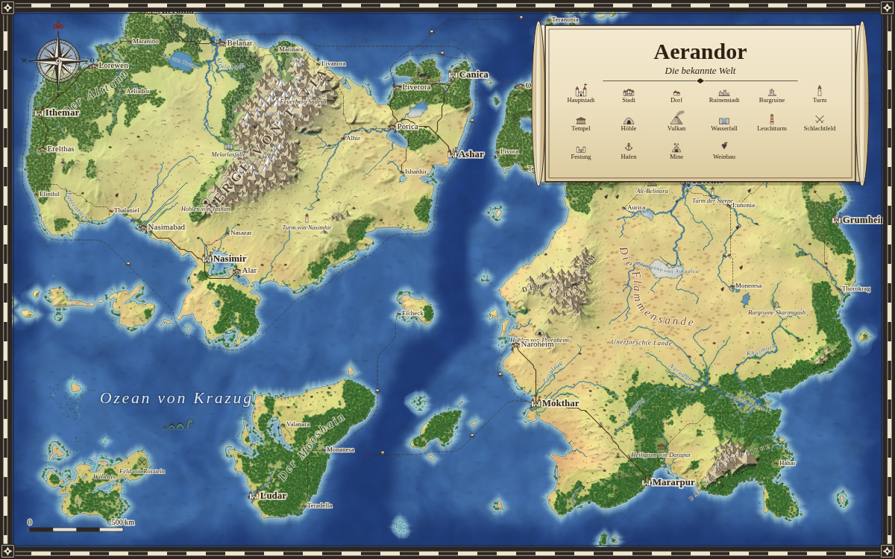
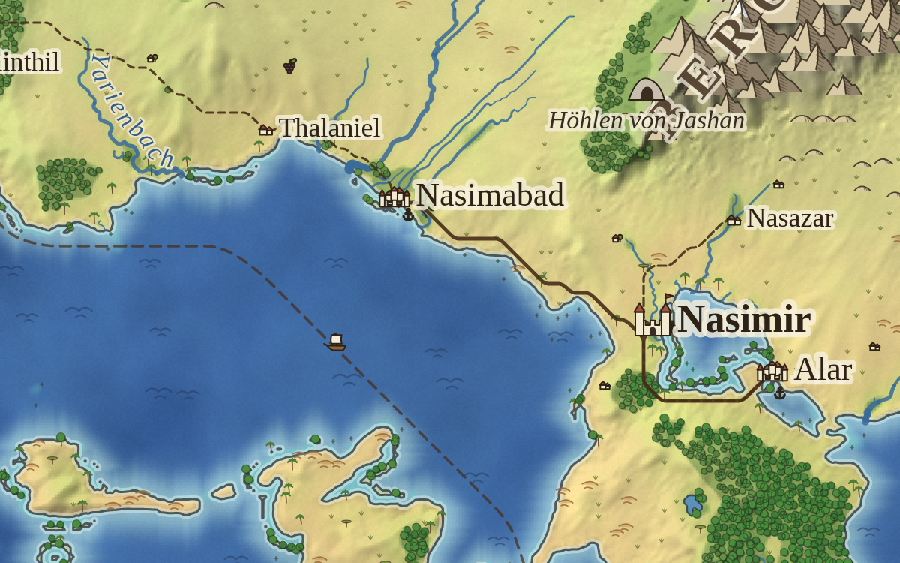

# 🗺️ Fantasy Map Maker

Ein Browser-Werkzeug zum Erstellen **realistisch aussehender Fantasy-Karten**, geografisch oder politisch. Karten lassen sich jederzeit weiterbearbeiten.





Die App läuft komplett im Browser. Es gibt keinen Server, keinen Build-Schritt und keine Abhängigkeiten. Nur der optionale KI-Assistent lädt das Anthropic-SDK aus dem Netz und braucht einen eigenen API-Schlüssel.

## Starten

- **Einfach:** `index.html` per Doppelklick im Browser öffnen (Chrome, Edge, Firefox oder Safari).
- **Mit lokalem Server** (empfohlen, damit das Speichern im Browser überall zuverlässig funktioniert):
  ```bash
  npx http-server -p 8080
  # danach http://localhost:8080 öffnen
  ```
- **Online:** Das Repository kann direkt über GitHub Pages veröffentlicht werden.

## Funktionen

### Weltgenerierung
- Höhenkarte aus fraktalem Rauschen mit Domain Warping und Gebirgsketten aus Gratrauschen
- Landformen: 2–3 etwa gleich große Kontinente (durch Meere getrennt), Superkontinent, große Insel, Archipel, Küstenregion oder freies Rauschen
- Einstellbar: Kartengröße (800 × 500 bis 3200 × 2000 – dieselbe Welt, größere Karten zeigen mehr Details), Landanteil, Gebirge, Strukturgröße, Flussdichte, Klima, Anzahl Staaten und Städte
- **Gleicher Seed = gleiche Welt**
- Klima und Landschaftsformen: Gletscher, Hochgebirge, Tundra, Nadelwald, Laub- und Mischwald, Regenwald, Wiesen, Steppe, Savanne, Wüste, Sumpf. Entlang von Flüssen entstehen grüne Täler und Auwälder.
- **Flüsse und Seen** aus einer echten Abflusssimulation (Senkenfüllung und Abflussakkumulation)
- **Erosion:** Simulierte Regentropfen formen verzweigte Täler, scharfe Grate und Schwemmebenen. Die Stärke ist einstellbar, und über „Erosion anwenden“ lässt sie sich auch auf bestehende Karten anwenden.
- **Klimazonen nach Breitengrad:** Jede Klima-Option entspricht einem Breitenbereich (z. B. Gemäßigt 70°–25° N, Äquator in der Mitte 72° N – 72° S). Daraus folgen Temperatur, Windgürtel und Regengürtel wie auf der Erde: feuchte Tropen, ein Wüstengürtel um 25°, feuchte Westküsten in mittleren Breiten, trockene Polargebiete.
- **Wind und Regenschatten:** Feuchte Luft zieht vom Meer übers Land und regnet sich an Gebirgen ab, dahinter wird es trocken. Die Windrichtung folgt automatisch den Windgürteln (Passat bis ~30°, Westwinde bis ~60°, polare Ostwinde) oder wird frei gewählt. Das Innere großer Kontinente wird in kühlen Breiten trockener, Tropenwälder halten sich durch Verdunstung selbst feucht.
- **Meeresströmungen:** Vereinfachte Ozeanwirbel mit warmen und kalten Randströmen. Warme Strömungen machen Küsten milder und feuchter (wie der Golfstrom), kalte erzeugen Küstenwüsten (wie der Humboldtstrom). Als Ebene „Meeresströmungen“ mit roten und blauen Pfeilen einblendbar.
- **Kontinentalplatten:** Wo Platten zusammenstoßen, falten sich lange Gebirgsketten mit Pässen und parallelen Graten auf. Im offenen Meer entstehen Inselbögen aus Vulkaninseln mit einem Tiefseegraben davor. Wo Platten auseinanderdriften, entstehen Grabenbrüche. An früheren Plattengrenzen liegen abgerundete Altgebirge, dazwischen Ebenen und Hügelland.
- **Kontinente** sind zufällig gedreht und gestreckt und haben Halbinseln und Nebenkerne.
- **Küstenvielfalt:**
  - Sandstrände an flachen Küsten, Klippen an Steilküsten, Watt im gemäßigten Flachwasser
  - Gewundene Fjorde mit vorgelagerten Schären an kühlen, hügeligen Küsten
  - Lagunen hinter schmalen Nehrungen an warmen Flachküsten
  - Türkisfarbene Riffe und Atolle (Ringriffe mit Lagune) in tropischen Meeren
- **Flussmündungen:** Große Flüsse an flachen Küsten schütten ein Delta auf und fächern sich in verzweigte Mündungsarme auf; an steileren Küsten weiten sie sich zum Trichter.
- **Salzseen:** In heißen Trockengebieten verdunsten Flüsse, Endseen werden zu weißen Salzpfannen („Salzsee von …“).
- **Weiche Übergänge** zwischen den Landschaftsformen, mit einzelnen Bäumen vor dem Waldrand
- **Gebirge als Ketten** mit Graten; Schnee nur oberhalb einer Schneegrenze, die vom Breitengrad abhängt, vor allem auf Graten. Baumgrenze mit Almwiesen darüber.
- **Flüsse mit Mäandern** im Flachland (große Flüsse in weiteren Bögen, mit abgeschnürten Altarmen) und stufenloser Breite von der Quelle bis zur Mündung
- **Natürliche Küsten** mit Buchten, Landzungen und vorgelagerten Inselchen
- **Straßennetz** zwischen den Städten: Wegsuche über das Gelände. Straßen meiden Gebirge und Gewässer und bündeln sich zu Hauptstraßen, kleine Orte hängen an Nebenwegen. Das Netz passt sich an, wenn Städte gesetzt, verschoben oder gelöscht werden.
- Staaten breiten sich von ihren Hauptstädten über das Gelände aus. Gebirge und Flüsse werden dabei zu natürlichen Grenzen.
- Namensgenerator mit sechs Sprachstilen (nordisch, elbisch, romanisch, germanisch, orientalisch, rau) für Staaten, Städte und Meere
- **Landschaftsnamen:** Gebirge, Wälder, Wüsten, Sümpfe, Seen und große Flüsse werden benannt („Die Sturmzinnen“, „Der Rabenforst“). Die Schrift folgt dem Gebirgskamm, der Form der Region oder dem Flusslauf.
- **Sehenswürdigkeiten:** Vulkane auf hohen Gipfeln, Wasserfälle an Gefällestufen, Leuchttürme auf Landspitzen, Höhlen, Ruinen, Burgruinen, Türme, Tempel und Schlachtfelder – jeweils mit Symbol und Namen
- **Große Mauern:** Auf manchen Kontinenten zieht sich eine Mauer mit Türmen quer über eine Landenge im Norden („Die Mauer“, „Der Nordwall“).
- **Schmuckbeschriftungen:** In leeren Weiten stehen Hinweise wie „Hier sind Drachen“, „Terra incognita“ oder „Ewiges Eis“, oft mit einem Seeungeheuer daneben. Sie lassen sich wie jeder Text verschieben, umbenennen oder löschen.

### Darstellungsstile
- **Geografisch:** natürliche, satellitenbildartige Farben, stufenlos aus Klima und Feuchtigkeit (Wüstensand bis tiefgrüner Wald), Wälder mit feiner Kronenstruktur, alpine Matten, Fels und Schnee im Gebirge, weiches Relief, Meerestiefen und Legende
- **Politisch:** Staatsfarben, Grenzen und Staatsnamen, die sich der Form des Staats anpassen
- **Antik:** Pergament-Look mit Gradnetz, Rahmen und Vignette
- **Fantasy:** gemalter Look klassischer Fantasy-Karten – helle Aquarellfarben, tiefblaues Meer mit hellem Küstensaum, gezeichnete Gebirgsketten mit Schraffur und Schneekappen, Wälder als dichte Baumflächen
- Küsten, Seeufer und Staatsgrenzen sind geglättete Vektorlinien; das Kartenbild wird in doppelter Auflösung berechnet
- Im Fantasy- und Antik-Stil: Städte als gezeichnete Burgen, ummauerte Städte und Dörfer, **Titelkartusche** mit Kartenname, Untertitel und Symbol-Legende, **verzierter Rahmen** mit Gradleiste und eine Windrose mit Lilie
- **Gezeichnete Symbole** (im Antik- und Fantasy-Stil standardmäßig an):
  - **Landschaft:** Berge, Hügel, Laub- und Nadelbäume, Dünen, Schilf, Grasbüschel in der Steppe, Akazien in der Savanne, Palmen an tropischen Küsten und in Oasen, Tundra-Büschel, Gletscherspalten
  - **Dörfer & Bauwerke:** Dörfer und Weiler an Flüssen und Straßen, Festungen auf Gebirgspässen, Häfen mit Anker, Brücken an Flussübergängen, Minen im Hügelland, Weinberge an warmen Hängen, Mauern
  - **Meer:** Wellen, Riffe, Klippen an Steilküsten, Seeungeheuer in den Weiten des Ozeans, Segelschiffe
  - **Seewege:** gestrichelte Schiffsrouten zwischen den Häfen verschiedener Landmassen
- Ebenen einzeln schaltbar: Relief, Flüsse, Straßen, Symbole, Dörfer & Bauwerke, Seewege, Meeressymbole, Staatsfarben, Grenzen, Städte, Staatsnamen, Texte, Meeresströmungen, Orte, Gradnetz, Kompass, Maßstab, Legende, Kartusche, Rahmen

### Bearbeiten
| Werkzeug | Taste | Funktion |
|---|---|---|
| Bewegen | `V` / Leertaste halten | Karte verschieben, Städte und Texte anklicken und ziehen |
| Anheben / Absenken | `H` / `T` | Gelände formen |
| Glätten / Einebnen | `G` / `E` | Gelände weicher machen oder auf eine Höhe bringen |
| Land / Meer | `L` / `M` | Neues Land aufschütten oder versenken |
| Gebirge | `B` | Zerklüftete Gebirgszüge malen |
| Landschaft | `W` | Landschaftsform malen (Wald, Wiese, Wüste, Sumpf …); „Automatisch“ entfernt die Übermalung |
| Staat malen | `P` | Gebiet einem Staat zuweisen („Herrenlos“ wirkt als Radierer) |
| Städte | `C` | Städte setzen, verschieben, umbenennen, zur Hauptstadt machen |
| Texte | `X` | Beschriftungen und Meeresnamen setzen; Staatsnamen verschieben und drehen |
| Orte | `O` | Sehenswürdigkeiten setzen, verschieben, umbenennen; „Neu verteilen“ erzeugt sie automatisch |
| Skizze | `K` | Umriss zeichnen → natürliches Land mit ausgefranster Küste; mit Shift wird Land versenkt |
| Gebirgslinie | `R` | Punkte klicken, Doppelklick oder Enter → Gebirgszug mit Graten und Pässen (Breite/Höhe: Pinsel-Regler) |
| Fluss | `F` | Flusslauf von der Quelle zur Mündung zeichnen; das Tal wird eingetieft |
| Verschieben | `U` | Landmasse anklicken und ziehen; Mausrad dreht, Shift+Mausrad skaliert; Städte und Namen wandern mit |
| Neu würfeln | `N` | Rechteck aufziehen → nur dieser Bereich wird neu generiert („Nochmal“ für einen weiteren Versuch) |

**Rechtsklick** auf die Karte öffnet ein Menü (Stadt/Ort/Text hier, Gebirge von hier, Mauer von hier, Mauer entfernen, Landmasse verschieben, Umgebung neu würfeln, Umbenennen). **Doppelklick** auf eine Stadt, einen Ort oder einen Text springt direkt zum Umbenennen.

Weitere Tasten: `Strg+Z` rückgängig, `Strg+Y` wiederholen, `Strg+S` als Datei speichern, `Entf` löscht die Auswahl, `[` `]` ändern die Pinselgröße, `+` `-` `0` zoomen.

Nach Geländeänderungen werden Flüsse, Seen und Küsten automatisch neu berechnet. Neues Land fällt an den angrenzenden Staat.

### KI-Assistent
Über **✨ KI-Assistent** beschreibst du in eigenen Worten, wie die Welt aussehen soll – etwa „ein langgezogener Kontinent im Westen mit einer Gebirgskette an der Ostküste und einer Wüste im Süden“. Claude (Opus 5.5) sieht ein Bild der Karte und setzt den Wunsch mit denselben Werkzeugen um, die es auch in der Werkzeugleiste gibt: Land aufschütten oder versenken, Gebirgszüge, Flüsse, Landschaften, Landmassen verschieben, Klima, Städte, Orte, Mauern und Namen. Jede Antwort lässt sich mit einem Klick rückgängig machen.

Dafür braucht man einen eigenen **Anthropic-API-Schlüssel** (aus der [Anthropic Console](https://console.anthropic.com/settings/keys)). Er wird nur im eigenen Browser gespeichert und nur an `api.anthropic.com` gesendet. Jede Nachricht kostet je nach Umfang einige Cent; der Assistent zeigt die ungefähren Kosten an. Lehnt Claude eine Anfrage ab, übernimmt automatisch ein anderes Claude-Modell.

### Speichern und Weiterbearbeiten
- **Automatisch im Browser** (IndexedDB). Unter „Meine Karten“ stehen alle Karten mit Vorschaubild.
- **Als Datei** (`.fmap`, komprimiertes JSON). Gut für Backups oder zum Weitergeben. Mit „Öffnen“ lädt man sie wieder.
- **PNG-Export** in 1× bis 6× Auflösung. Für den Druck wird das Kartenbild in höherer Auflösung neu berechnet, damit es scharf bleibt.

## Projektstruktur

```
index.html        Oberfläche
css/style.css     Gestaltung
js/core.js        Zufall (Seed), Simplex-Rauschen, Heap, Hilfsfunktionen
js/names.js       Namensgenerator
js/regions.js     Landschaftsregionen, Mittellinien, Landschafts- und Flussnamen
js/pois.js        Sehenswürdigkeiten (Platzierung und Namen)
js/icons.js       Gezeichnete Symbole für Städte, Sehenswürdigkeiten, Bauwerke, Schiffe und Seeungeheuer
js/decor.js       Kartenschmuck: Dörfer, Bauwerke, Mauern, Meeressymbole, Seewege, Schmuckbeschriftungen
js/sculpt.js      „Skizze → Gelände“: Umrisse, Gebirgslinien, Flüsse, Verschieben, Neu würfeln
js/ai.js          KI-Assistent (Chat, Werkzeuge für Claude, Kartenübersicht)
js/biomes.js      Landschaftsformen (Einteilung und Farben)
js/contours.js    Geglättete Konturen (Küsten, Seeufer, Grenzen)
js/roads.js       Straßennetz (A*-Wegsuche)
js/erosion.js     Hydraulische Erosion
js/climate.js     Niederschlag aus Wind und Regenschatten, Meeresströmungen
js/derive.js      Klima, Flüsse und Seen, Küstenabstand, Staatsstatistiken
js/generator.js   Weltgenerierung (Gelände, Feuchtigkeit, Staaten, Städte, Meere)
js/symbols.js     Landschaftssymbole (Berge, Hügel, Bäume, Dünen, Schilf, Palmen …)
js/render.js      Darstellung (Rasterbild und Vektorebene)
js/storage.js     Speichern und Laden (Datei und IndexedDB)
js/editor.js      Werkzeuge, Pinsel, Zoom, Rückgängig
js/app.js         Verknüpfung von allem und Bedienelemente
```
