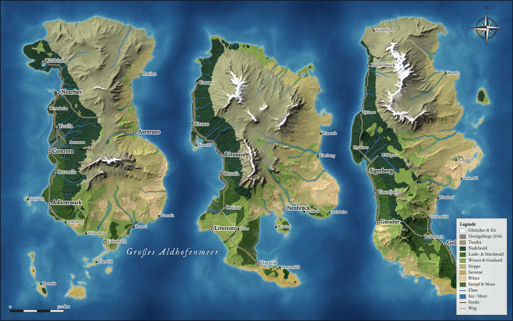
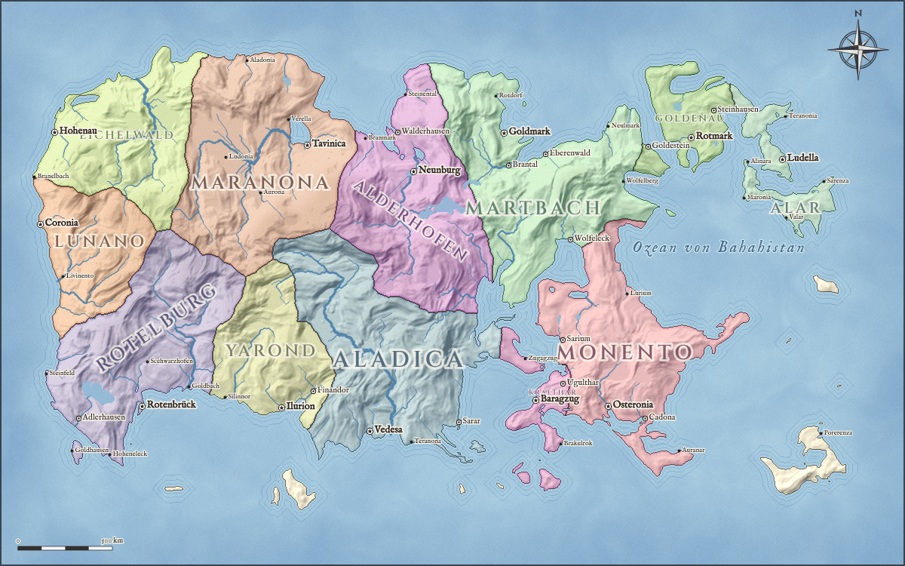

# 🗺️ Fantasy Map Maker

Ein Browser-Werkzeug zum Erstellen **realistisch aussehender Fantasy-Karten**, geografisch oder politisch. Karten lassen sich jederzeit weiterbearbeiten.




Die App läuft komplett im Browser. Es gibt keinen Server, keinen Build-Schritt und keine Abhängigkeiten.

## Starten

- **Einfach:** `index.html` per Doppelklick im Browser öffnen (Chrome, Edge, Firefox oder Safari).
- **Mit lokalem Server** (empfohlen, damit das Speichern im Browser überall zuverlässig funktioniert):
  ```bash
  npx http-server -p 8080
  # danach http://localhost:8080 öffnen
  ```
- **Online:** Das Repository kann direkt über GitHub Pages veröffentlicht werden.

## Funktionen

### Weltgenerierung
- Höhenkarte aus fraktalem Rauschen mit Domain Warping und Gebirgsketten aus Gratrauschen
- Landformen: 2–3 etwa gleich große Kontinente (durch Meere getrennt), Superkontinent, große Insel, Archipel, Küstenregion oder freies Rauschen
- Einstellbar: Landanteil, Gebirge, Strukturgröße, Flussdichte, Klima, Anzahl Staaten und Städte
- **Gleicher Seed = gleiche Welt**
- Klima und Landschaftsformen: Gletscher, Hochgebirge, Tundra, Nadelwald, Laub- und Mischwald, Regenwald, Wiesen, Steppe, Savanne, Wüste, Sumpf. Entlang von Flüssen entstehen grüne Täler und Auwälder.
- **Flüsse und Seen** aus einer echten Abflusssimulation (Senkenfüllung und Abflussakkumulation)
- **Erosion:** Simulierte Regentropfen formen verzweigte Täler, scharfe Grate und Schwemmebenen. Die Stärke ist einstellbar, und über „Erosion anwenden“ lässt sie sich auch auf bestehende Karten anwenden.
- **Wind und Regenschatten:** Feuchte Luft zieht vom Meer übers Land und regnet sich an Gebirgen ab, dahinter wird es trocken. Die Windrichtung folgt automatisch den Klimazonen (Westwinde, Passat aus Osten) oder wird frei gewählt.
- **Gebirge als Ketten** mit Graten; Schnee nur oberhalb einer Schneegrenze, die vom Breitengrad abhängt, vor allem auf Graten. Baumgrenze mit Almwiesen darüber.
- **Flüsse mit Mäandern** im Flachland und stufenloser Breite von der Quelle bis zur Mündung
- **Natürliche Küsten** mit Buchten, Landzungen und vorgelagerten Inselchen
- **Straßennetz** zwischen den Städten: Wegsuche über das Gelände. Straßen meiden Gebirge und Gewässer und bündeln sich zu Hauptstraßen, kleine Orte hängen an Nebenwegen. Das Netz passt sich an, wenn Städte gesetzt, verschoben oder gelöscht werden.
- Staaten breiten sich von ihren Hauptstädten über das Gelände aus. Gebirge und Flüsse werden dabei zu natürlichen Grenzen.
- Namensgenerator mit sechs Sprachstilen (nordisch, elbisch, romanisch, germanisch, orientalisch, rau) für Staaten, Städte und Meere

### Darstellungsstile
- **Geografisch:** Landschaftsformen mit eigener Textur (Baumkronen in Wäldern, Dünen in Wüsten, Wasserlachen in Sümpfen), dazu Relief, Flüsse, Meerestiefen und eine Legende
- **Politisch:** Staatsfarben, Grenzen und Staatsnamen, die sich der Form des Staats anpassen
- **Antik:** Pergament-Look mit Gradnetz, Rahmen und Vignette
- Küsten, Seeufer und Staatsgrenzen sind geglättete Vektorlinien; das Kartenbild wird in doppelter Auflösung berechnet
- Ebenen einzeln schaltbar: Relief, Flüsse, Straßen, Staatsfarben, Grenzen, Städte, Staatsnamen, Texte, Gradnetz, Kompass, Maßstab, Legende

### Bearbeiten
| Werkzeug | Taste | Funktion |
|---|---|---|
| Bewegen | `V` / Leertaste halten | Karte verschieben, Städte und Texte anklicken und ziehen |
| Anheben / Absenken | `H` / `T` | Gelände formen |
| Glätten / Einebnen | `G` / `E` | Gelände weicher machen oder auf eine Höhe bringen |
| Land / Meer | `L` / `M` | Neues Land aufschütten oder versenken |
| Gebirge | `B` | Zerklüftete Gebirgszüge malen |
| Landschaft | `W` | Landschaftsform malen (Wald, Wiese, Wüste, Sumpf …); „Automatisch“ entfernt die Übermalung |
| Staat malen | `P` | Gebiet einem Staat zuweisen („Herrenlos“ wirkt als Radierer) |
| Städte | `C` | Städte setzen, verschieben, umbenennen, zur Hauptstadt machen |
| Texte | `X` | Beschriftungen und Meeresnamen setzen; Staatsnamen verschieben und drehen |

Weitere Tasten: `Strg+Z` rückgängig, `Strg+Y` wiederholen, `Strg+S` als Datei speichern, `Entf` löscht die Auswahl, `[` `]` ändern die Pinselgröße, `+` `-` `0` zoomen.

Nach Geländeänderungen werden Flüsse, Seen und Küsten automatisch neu berechnet. Neues Land fällt an den angrenzenden Staat.

### Speichern und Weiterbearbeiten
- **Automatisch im Browser** (IndexedDB). Unter „Meine Karten“ stehen alle Karten mit Vorschaubild.
- **Als Datei** (`.fmap`, komprimiertes JSON). Gut für Backups oder zum Weitergeben. Mit „Öffnen“ lädt man sie wieder.
- **PNG-Export** in 1× bis 4× Auflösung, z. B. für den Druck.

## Projektstruktur

```
index.html        Oberfläche
css/style.css     Gestaltung
js/core.js        Zufall (Seed), Simplex-Rauschen, Heap, Hilfsfunktionen
js/names.js       Namensgenerator
js/biomes.js      Landschaftsformen (Einteilung und Farben)
js/contours.js    Geglättete Konturen (Küsten, Seeufer, Grenzen)
js/roads.js       Straßennetz (A*-Wegsuche)
js/erosion.js     Hydraulische Erosion
js/climate.js     Niederschlag aus Wind und Regenschatten
js/derive.js      Klima, Flüsse und Seen, Küstenabstand, Staatsstatistiken
js/generator.js   Weltgenerierung (Gelände, Feuchtigkeit, Staaten, Städte, Meere)
js/render.js      Darstellung (Rasterbild und Vektorebene)
js/storage.js     Speichern und Laden (Datei und IndexedDB)
js/editor.js      Werkzeuge, Pinsel, Zoom, Rückgängig
js/app.js         Verknüpfung von allem und Bedienelemente
```
